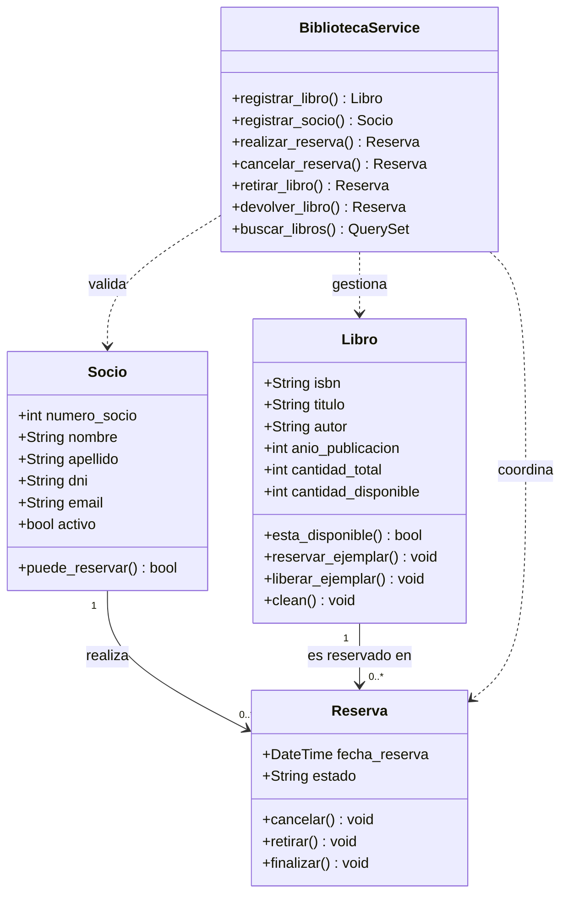

# Sistema de Reserva de Libros de una Biblioteca

Trabajo Práctico de **Diseño de Sistemas Orientado a Objetos**, desarrollado en **Python** y **Django** utilizando el ORM para la persistencia en SQLite e interacción exclusiva mediante consola.

## Requisitos previos

* Python 3.10 o superior
* Django

## Instalación y Ejecución

1. Clonar el repositorio y entrar a la carpeta del proyecto:
   ```bash
   git clone https://github.com
   cd mi-proyecto-django
   ```

2. Crear y activar el entorno virtual:
   ```bash
   python -m venv venv
   venv/Scripts/activate
   ```

3. Instalar las dependencias:
   ```bash
   pip install -r requirements.txt
   ```

4. Aplicar las migraciones de la base de datos:
   ```bash
   python manage.py migrate
   ```

5. Iniciar el sistema desde consola:
   ```bash
   python manage.py biblioteca
   ```

## Arquitectura y Diseño Orientado a Objetos

El proyecto separa estrictamente la interfaz de usuario, la lógica de negocio y el modelo de dominio:

* **`emi/models.py`**: Define las entidades principales (`Libro`, `Socio`, `Reserva`) encapsulando sus atributos, restricciones de integridad y cambios de estado propios (`reservar_ejemplar()`, `liberar_ejemplar()`, `puede_reservar()`, `cancelar()`, `retirar()`, `finalizar()`).
* **`emi/services.py`**: Contiene la clase `BibliotecaService`, encargada de coordinar operaciones entre múltiples entidades, validar reglas de negocio y asegurar transacciones atómicas en base de datos.
* **`emi/management/commands/biblioteca.py`**: Implementa el comando personalizado de Django con el menú interactivo por consola y la captura de excepciones (`ValidationError`, `ValueError`).

## Diagrama de Clases

